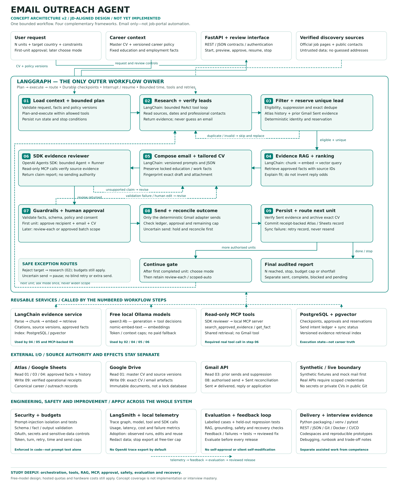

# Email Outreach Agent

The Email Outreach Agent is a proposed Python application that converts a number of outreach units, target country, verified CV and career policy into researched, personalised, authorised emails. It discovers professional contacts, checks eligibility and duplicates, retrieves supporting evidence, preserves fixed career facts, and prepares tailored CVs and messages.

LangGraph owns planning, routing, persistent state, approval checkpoints and bounded recovery. LangChain supplies prompts, tool integrations and retrieval. An OpenAI Agents SDK specialist reviews claims through read-only MCP tools; it cannot send emails. Local Ollama models provide generation and embeddings without paid inference APIs. The first email requires approval; remaining emails follow the user's selected review or bounded automation mode.

The design covers Python packaging, virtual environments, pytest, REST APIs, JSON, authentication, error handling, Git, Docker and CI/CD. It demonstrates tool calling, structured outputs, token budgets, context management, ReAct, plan-and-execute, deterministic alternatives, chunking, embeddings and vector search. Security addresses prompt injection, output validation and sensitive data. LangSmith supports tracing, evaluations and usage, cost and adoption telemetry. Release gates, feedback, debugging, rapid prototyping and documented trade-offs support teamwork, learning and interview walkthroughs. Sending outcomes remain auditable, with uncertain sends reconciled before retrying. This document specifies capabilities; implementation and competence require separate evidence.

---

**Concept architecture v2 · 17 November 2026 · proposed design, not an implementation report.**

## Concept architecture

The diagram is embedded as Mermaid so this Markdown remains self-contained. View it with Mermaid support, such as GitHub Markdown. Solid arrows represent requests, control flow or data exchange as labelled; dotted arrows represent cross-cutting controls, telemetry or release governance. Step IDs match the separate visual export.

```mermaid
flowchart TB
  subgraph IN["USER INPUTS AND EXTERNAL SOURCES"]
    U["User: N email units, country, custom constraints"]
    C["Master CV: verified facts and locked sections"]
    P["Career policy: versioned goals and communication rules"]
    API["FastAPI review interface: REST, JSON, authentication, errors"]
    WEB["Official job pages and published professional contacts: untrusted data"]
    AT["Atlas / Google Sheets: approved career facts and outreach history"]
    DR["Google Drive: original CV and immutable generated documents"]
    GM["Gmail API: history, authorised sending and Sent readback"]
  end

  subgraph RUN["LANGGRAPH: SOLE WORKFLOW OWNER"]
    A["01 Load context and bounded plan: validated request, policy and source versions"]
    B["02 Research: LangChain bounded ReAct and read-only discovery tools"]
    D["03 Filter and reserve: eligibility, suppression, exact dedupe and locks"]
    R["04 Ground and rank: LangChain RAG, evidence IDs and transparent fit score"]
    W["05 Compose: LangChain structured email and CV with locked facts"]
    V["06 Review: OpenAI Agents SDK evidence specialist; read-only MCP"]
    H["07 Validate and authorise: deterministic guardrails plus human approval"]
    S["08 Send and reconcile: deterministic dispatcher; uncertain outcome pauses"]
    L["09 Persist and route: exact receipt, CV archive and Atlas writeback"]
    MODE["Continue gate: after first completed unit ask review-each or scoped-auto; retain choice"]
    REPORT["Audited report: completed, skipped, blocked, uncertain and sync-pending"]
    HOLD["Pause for reconciliation or human resolution; do not resend blindly"]
  end

  U --> API
  API --> A
  C --> A
  P --> A
  DR -->|read original| A
  AT -->|approved snapshot| A
  A --> B
  B <-->|read and verify sources| WEB
  B --> D
  AT -->|historical identities| D
  GM -->|prior Sent reconciliation| D
  D -->|valid and unique| R
  D -->|skip; bounded replacement| B
  R --> W
  W --> V
  V -->|structured claim report| H
  V -->|unsupported claim; bounded revision| W
  H -->|edit or validation failure; bounded revision| W
  H -->|reject target; bounded replacement| B
  H -->|first exact approval or valid later scope| S
  API <-->|preview and explicit decision| H
  S <-->|send and verify| GM
  S -->|confirmed Sent evidence| L
  S -->|ambiguous outcome| HOLD
  HOLD -->|confirmed same message| L
  HOLD -->|unresolved or cancelled| REPORT
  L -->|immutable CV and email artefacts| DR
  L -->|receipt-backed operational record| AT
  L -->|sync failed: retry recording only| L
  L -->|more units within approved limits| MODE
  MODE <-->|ask once after first completed unit| API
  MODE --> B
  L -->|target reached, cap, stop or shortfall| REPORT
  B -->|discovery budget exhausted| REPORT
  H -->|repair budget exhausted or unsafe| REPORT
  A -->|invalid input or unavailable dependency| REPORT

  subgraph SERVICES["BOUNDED SERVICES: NOT SECOND WORKFLOW CONTROLLERS"]
    LC["LangChain evidence service: parse, chunk, embed, retrieve, cite"]
    MODEL["Local Ollama: qwen3:4b generation and nomic-embed-text embeddings"]
    MCP["Local read-only MCP server: search_approved_evidence and get_fact"]
    DB[("PostgreSQL + pgvector: checkpoints, approvals, reservations, send ledger and evidence index")]
    BUD["Global budgets: context, output tokens, turns, retries, time, N and consent"]
  end

  C --> LC
  AT -->|approved evidence only| LC
  DR -->|source versions| LC
  LC <-->|vector index| DB
  LC <-->|embeddings| MODEL
  R <-->|retrieve evidence bundle| LC
  W <-->|prompt and structured generation| MODEL
  B <-->|tool decisions| MODEL
  V <-->|OpenAI-compatible local model adapter| MODEL
  V <-->|MCP client / tool calls| MCP
  MCP <-->|approved retrieval only| LC
  A <-->|checkpoint and source references| DB
  D <-->|reserve identity| DB
  H <-->|approval hash and scope| DB
  S <-->|send intent and reconciliation state| DB
  L <-->|receipt and sync status| DB
  BUD -.-> A
  BUD -.-> B
  BUD -.-> R
  BUD -.-> W
  BUD -.-> V
  BUD -.-> H
  BUD -.-> S

  subgraph QUALITY["SECURITY, OBSERVABILITY AND DELIVERY LIFECYCLE"]
    SEC["Security: untrusted-content isolation, prompt-injection tests, schema validation, OAuth, secret isolation and redaction"]
    OBS["LangSmith plus local metrics: correlated traces, usage, cost, adoption, failures and quota controls"]
    FB["Human feedback and failure cases: sanitise, label and version"]
    EVAL["Evaluation gates: pytest, RAG quality, groundedness, safety, restart recovery and SDK/model/MCP compatibility"]
    CI["Engineering: Python packaging and venv, Git review, CI/CD, Docker, Codespaces and support notes"]
    REL["Reviewed release: passed checks, versioned prompts and explicit live permissions"]
  end

  SEC -.-> API
  SEC -.-> B
  SEC -.-> LC
  SEC -.-> H
  SEC -.-> S
  RUN -.->|redacted events from every stage| OBS
  H -->|edits and rejection reasons| FB
  REPORT -->|observed outcomes and failures| FB
  OBS --> FB
  FB --> EVAL
  EVAL -->|release gate| CI
  CI --> REL
  REL -.->|next version; not self-modification during a run| A

  classDef step fill:#F0FAF8,stroke:#008C83,color:#101820,stroke-width:2px;
  classDef service fill:#FFFFFF,stroke:#008C83,color:#101820;
  classDef control fill:#E2F5F1,stroke:#005F59,color:#101820,stroke-width:2px;
  class A,B,D,R,W,V,H,S,L step;
  class U,C,P,API,WEB,AT,DR,GM,LC,MODEL,MCP,DB,OBS,FB,EVAL,CI service;
  class MODE,REPORT,HOLD,BUD,SEC,REL control;
```



### Concept architecture image (SVG)

The SVG below is the approved visual companion to the Mermaid flow above. It is a real file stored alongside this document at `assets/Email_Outreach_Agent_Concept_v2.svg`, so it renders in GitHub, Codespaces and ordinary Markdown previewers when the directory is kept intact.



### Classified implementation folder structure

**Classification:** `[CORE]` orchestration and state · `[NODE]` LangGraph steps · `[SDK]` OpenAI specialist · `[RAG]` retrieval · `[MCP]` tools · `[EXT]` external adapters · `[DATA]` transactional storage · `[SAFE]` guardrails · `[OBS]` tracing/metrics · `[EVAL]` evaluation · `[API]` REST UI · `[OPS]` infrastructure · `[TEST]` behavioural tests.

```text
email-outreach-agent/
├── INSTRUCTIONS.md                          [SPEC] Single architecture and build document
├── README.md                                [SPEC] Scaffold status; points to INSTRUCTIONS.md
├── assets/                                  [ASSET] Embedded architecture images
│   ├── Email_Outreach_Agent_Concept_v2.png
│   └── Email_Outreach_Agent_Concept_v2.svg
├── pyproject.toml                           [OPS] Python packaging and dependencies
├── langgraph.json                          [OPS] Official LangGraph graph entry point
├── .env.example                            [OPS] Safe configuration placeholder
├── .devcontainer/devcontainer.json         [OPS] Codespaces development container
├── .github/workflows/ci.yml                [OPS] CI scaffold; not a full release gate
├── Dockerfile                              [OPS] Container build scaffold
├── docker-compose.yml                      [OPS] Local service composition scaffold
├── src/outreach_agent/                     [CORE] Installable Python package
│   ├── main.py                             [API] FastAPI bootstrap
│   ├── api/                                [API] HTTP boundaries
│   │   ├── routes.py                       [API] Routes / approval endpoints
│   │   └── schemas.py                      [API] JSON request-response validation
│   ├── domain/models.py                    [CORE] Immutable facts, IDs, receipts and units
│   ├── orchestration/                      [CORE] Sole LangGraph controller
│   │   ├── graph.py                        [CORE] Graph nodes and edges
│   │   ├── state.py                        [CORE] Typed shared state
│   │   ├── routing.py                      [CORE] Conditional routing and stop rules
│   │   └── orchestrator.py                 [CORE] Start, resume, cancel
│   ├── nodes/                              [NODE] Executable workflow steps
│   │   ├── load_context.py                 [01] Validate inputs and policy
│   │   ├── research.py                     [02] Source-backed lead discovery
│   │   ├── deduplicate.py                  [03] Suppression and reservation
│   │   ├── retrieval.py                    [04] Evidence retrieval
│   │   ├── ranking.py                      [04] Explainable suitability score
│   │   ├── cv_writer.py                    [05] Grounded CV preparation
│   │   ├── email_writer.py                 [05] Grounded email drafting
│   │   ├── evidence_review.py              [06] Invoke SDK evidence specialist
│   │   ├── validation.py                   [07] Deterministic checks
│   │   ├── approval.py                     [07] HITL and approval hash
│   │   ├── dispatch.py                     [08] Send/reconcile approved intent
│   │   ├── persist.py                      [09] Drive and Atlas writeback
│   │   ├── continuation.py                 [09] N−1 review/auto choice
│   │   └── report.py                       [END] Truthful run report
│   ├── agents/evidence_reviewer.py          [SDK] OpenAI Agent/Runner, read-only
│   ├── models/                             [MODEL] Local LLM and embeddings
│   │   ├── llm.py
│   │   └── embeddings.py
│   ├── rag/                                [RAG] LangChain retrieval pipeline
│   │   ├── ingestion.py
│   │   ├── chunking.py
│   │   ├── vector_store.py
│   │   └── retrieval_service.py
│   ├── tools/                              [MCP] Typed tools and read-only MCP
│   │   ├── research_tools.py
│   │   └── mcp_server.py
│   ├── integrations/                       [EXT] Replaceable provider adapters
│   │   ├── public_sources.py
│   │   ├── atlas.py
│   │   ├── drive.py
│   │   └── gmail.py
│   ├── persistence/                        [DATA] Postgres state and send ledger
│   │   ├── database.py
│   │   ├── checkpoints.py
│   │   ├── outbox.py
│   │   └── repository.py
│   ├── guardrails/                         [SAFE] Security, policy and privacy
│   │   ├── security.py
│   │   └── policies.py
│   ├── observability/                      [OBS] Redacted tracing and telemetry
│   │   ├── tracing.py
│   │   └── metrics.py
│   └── evaluation/evaluators.py            [EVAL] Evaluation adapters
├── evaluation/datasets/                    [EVAL] Versioned synthetic + held-out cases
├── data/synthetic/                         [DATA] Example records; no private CVs
├── data/generated/                         [DATA] Ignored local artifacts
├── migrations/                             [DATA] SQL schema migrations
└── tests/                                  [TEST] Unit, integration, security, E2E
    ├── unit/
    ├── integration/
    ├── adversarial/
    └── end_to_end/
```

### Concept → Python ownership map

| Concept step | Owner and supporting modules | Study priority |
|---|---|---|
| 01 · Load context / plan | `nodes/load_context.py`; `api/schemas.py`; `orchestration/state.py` | **Study deeply** |
| 02 · Discover and verify | `nodes/research.py`; `tools/research_tools.py`; `integrations/public_sources.py` | **Study deeply** |
| 03 · Dedupe and reserve | `nodes/deduplicate.py`; `persistence/outbox.py`; `guardrails/policies.py` | **Study deeply** |
| 04 · Ground and rank | `nodes/retrieval.py`, `ranking.py`; `rag/*`; `models/embeddings.py` | **Study deeply** |
| 05 · Generate CV and email | `nodes/cv_writer.py`, `email_writer.py`; `models/llm.py` | **Study deeply** |
| 06 · Evidence review | `nodes/evidence_review.py`; `agents/evidence_reviewer.py`; `tools/mcp_server.py` | **Study deeply** |
| 07 · Validate and approve | `nodes/validation.py`, `approval.py`; `guardrails/*`; `orchestration/state.py` | **Study deeply** |
| 08 · Dispatch and reconcile | `nodes/dispatch.py`; `integrations/gmail.py`; `persistence/outbox.py` | **Study deeply** |
| 09 · Persist, continue, report | `nodes/persist.py`, `continuation.py`, `report.py`; Atlas and Drive adapters | **Study deeply** |
| System entry / deployment | `main.py`, `api/*`, Docker, Codespaces and `langgraph.json` | System architecture |
| Monitoring and release | `observability/*`, `evaluation/*`, `tests/*`, `.github/workflows/ci.yml` | Study deeply for evaluation; system depth for CI |

**Scaffold status:** The matching archive contains actual classified folders and Python starter files, but **not** a functional outreach agent. `graph.py` contains only a harmless placeholder graph; all side-effect integrations are unimplemented, and the only runnable test is a package smoke test. Do not treat the presence of a module or the scaffold CI as JD implementation evidence.

**Single-document rule:** Keep concept, future system-design and deployment diagrams, build instructions and JD traceability inside this `INSTRUCTIONS.md`. The sub-files are implementation code, configuration, tests and image assets—not additional architecture Markdown pages. Later Work implementation should expand module contracts and real tests before enabling any live provider action.

## Complete JD-to-concept coverage

Every item below is **planned design coverage**. Verification evidence must be produced during implementation.

| JD capability or responsibility | Where it belongs in this concept | Evidence required later |
| --- | --- | --- |
| Build agents, tools, prompts, workflows and delivery integrations | Steps 01–09; four framework roles; Google and MCP adapters | One reproducible end-to-end run with source and receipt references |
| Human approval and safe failure handling | Step 07; persistent interrupts; step 08 reconciliation; step 09 sync recovery | Approval, rejection, restart, timeout and partial-write tests |
| Maintain evaluation cases and run before every release | Evaluation → CI/CD → reviewed release | Versioned datasets and a release blocked by a failing regression |
| Tracing; usage, cost and adoption | LangSmith and local metrics across every stage | Correlated traces; actual or explicitly estimated usage; meaningful single-user adoption metrics |
| Support implementation, testing and troubleshooting with delivery teams | Reusable adapters, reviewed contracts, runbook and failure reproductions | An issue-to-fix example and reproducible diagnosis; team collaboration is not fabricated |
| Improve from feedback, evaluation and telemetry | Human feedback → labelled regression cases → reviewed changes → release | Before/after evaluation on held-out cases; no automatic policy rewriting |
| Clean, testable Python | Typed boundaries, pure validators and deterministic side-effect adapters | Unit tests, static checks and explainable interfaces |
| Virtual environments and packaging | Reproducible Python environment and installable package | Clean-environment installation and package smoke test |
| Unit testing with pytest | Unit, integration, safety and recovery suites | Passing assertions with failures and skipped integrations honestly reported |
| Build and call REST APIs; JSON; authentication and errors | FastAPI boundary; typed provider clients; OAuth and secrets outside model context | Contract tests for invalid JSON, authentication, expiry, timeouts and rate limits |
| Day-to-day Git; CI/CD; Docker | Reviewed commits; automated checks; reproducible container release | Diff/review evidence, CI outcome and a container startup demonstration |
| Prompt design and LLM APIs | Steps 01, 02, 05 and 06; versioned prompt templates and local inference adapters | Controlled prompt experiment and a real local-model call |
| Tool/function calling and structured JSON | LangChain research tools; SDK reviewer; validated output schemas | Allowed-tool calls, malformed JSON rejection and bounded repair |
| Token budgets and context limits | Global budgets applied to prompts, tools, retrieved text and output reserve | Overflow, truncation and exhaustion tests; no silent loss of locked policy |
| At least one substantial framework-based workflow | LangGraph is the outer orchestrator; OpenAI Agents SDK is the bounded reviewer | Explain state, edges, interrupts, ownership and an actual run |
| ReAct, plan-and-execute and routing | Bounded research tool/action loop; validated plan; deterministic conditional routes | Trace a tool decision, observation, branch and stopping condition |
| Know when a script is enough | Dedupe, eligibility rules, rendering, approval checks, sending and accounting | Explain why these operations do not need autonomous LLM decisions |
| RAG: chunking, embeddings, vector-store queries | LangChain evidence service; local embeddings; PostgreSQL/pgvector | Retrieval recall, source-filtering, provenance and insufficient-evidence tests |
| MCP awareness and exposing a tool | Local read-only MCP server called by the SDK reviewer | Real tool discovery and invocation with validated arguments and responses |
| Test LLM output with evaluation/tracing tooling | LangSmith, pytest, gold fixtures and human labels | Groundedness, relevance, schema and safety evaluations—not model self-approval alone |
| Prompt injection, output validation and sensitive data | Security controls across retrieval, generation, tools and sending | Adversarial fixtures; restricted tools; secret/PII redaction; no authority from retrieved text |
| Problem solving, debugging and rapid prototyping | A single-unit vertical slice, fault injection and a development failure log | Reproduce, diagnose, fix and regression-test a genuine defect |
| Learn tools quickly and explain technical trade-offs | Bounded compatibility experiments and short decision records in this same document | Explain the four framework roles, state ownership, cost and reliability trade-offs |
| Walk through a project, tests and what went wrong | Traceable runtime plus assistance-aware contribution and incident records | Independent explanation, code changes and debugging—not reading a diagram alone |

## Design decisions that later layers must preserve

### Framework ownership

**LangGraph is the only outer workflow controller.** It owns run state, routing, checkpoints, budgets and human interruptions. LangChain supplies model/tool adapters, prompts, structured generation and RAG. These services execute inside graph steps; a Python file is not intrinsically an agent or node.

**OpenAI Agents SDK is a required, bounded specialist in this design, not an optional badge.** Step 06 uses an `Agent` and `Runner` for evidence review and calls the local read-only MCP service. It returns a typed claim report to LangGraph. It has no Gmail tool, no authority to approve a send, no independent persistent campaign state and no ability to bypass deterministic validators. Its internal tool loop has a turn budget. A second opinion from the same model is not independent proof of factual correctness.

**LangSmith is the selected tracing/evaluation integration.** Correlate graph and specialist events by run/unit IDs. Replace the SDK's default OpenAI trace exporter with a redaction-safe LangSmith processor only when export is enabled; do not disable all SDK tracing and then expect its processor to collect spans. With export disabled or a quota reached, use local structured logs/evaluations and report the reduced observability. Never silently export full private CVs, email bodies or credentials. [S1–S5]

### The user-controlled workflow

The career letter is parsed into a versioned preference schema; it is not allowed to override platform safety or authorise tools. The master CV and approved source records supply facts. Locked education and employment sections remain unchanged. Retrieved job pages are evidence, not instructions. Unknown eligibility or unsupported claims require a hold, omission or explicit question, not invention.

The first proposed unit must show the exact recipient, email, CV and source evidence. Approval binds their versions or hashes. Any subsequent edit invalidates that exact approval. Only after the first confirmed send is recorded does the user choose **review every remaining email** or **automate within the approved remaining N−1 scope**. The approval gate still runs for every automated unit; automation bypasses repeated human clicks, not safety checks. Scope includes country, role constraints, count, expiry and stop/revoke controls.

No model may send mail directly. A deterministic dispatcher checks consent, reservation, current suppression/history, final artefact fingerprints and remaining budget immediately before sending. Use local uniqueness constraints and a send ledger. A Gmail timeout does not prove failure: pause, reconcile the same intent against provider evidence, and escalate unresolved outcomes. Do not claim atomic exactly-once delivery across Gmail and the database. If Gmail succeeded but Atlas synchronisation failed, retry the recording operation only.

A completed email-only unit requires a provider-confirmed Sent copy, the exact archived CV/email and a recorded operational receipt. A Sent copy does **not** prove inbox delivery, employer interest or a formal application. Report drafts, uncertain sends, known bounces, sync-pending units and completed units separately. A confirmed bounce is not a successful contact. Requested N is a hard sending scope, not permission for unlimited replacement sends; additional attempts beyond the authorised cap require approval. Invalid unsent candidates may be replaced only within the discovery budget.

### Data and tool boundaries

Atlas/Google Sheets remains the canonical approved career/outreach record; Google Drive holds documents. PostgreSQL owns transactional execution state, reservations, approvals and the send ledger; pgvector holds a versioned retrieval index, not an alternative career truth source. Reconcile writeback with stable provider IDs. Do not treat Sheets as a locking database or a vector search as an exact duplicate check.

The Codespaces project needs explicit authenticated adapters or approved exports. Existing ChatGPT plugins do not automatically become Python imports or transfer credentials into Codespaces. The MCP server exposes only `search_approved_evidence` and `get_fact` in this concept. It calls the shared LangChain retrieval service and returns source IDs; Gmail is deliberately absent from its tool list. [S6]

Discovery uses permitted public pages, official career/ATS sources, public recruiting contacts and user-supplied seed URLs. No paid search API is mandatory. Without a verified discovery source, return a bounded shortfall rather than fabricate contacts or assume unlimited free web search. Do not scrape restricted accounts, guess addresses, infer consent from a job listing or repeat suppressed approaches.

### Free-model and cost boundary

Use local **Ollama `qwen3:4b`** for generation and tool decisions, and **`nomic-embed-text`** for embeddings. The SDK specialist uses an explicitly configured OpenAI-compatible local Chat Completions adapter. The SDK library does not require purchasing OpenAI model inference for this design. Compatibility is not assumed: tool calls, structured results, budgets and MCP invocation must pass a real smoke test for the pinned package/model versions. No automatic paid-model fallback is permitted. CPU latency and available memory remain implementation constraints. [S1, S7–S10]

The target is **zero paid inference and no mandatory paid services**, not unlimited free hosting. GitHub Codespaces and LangSmith have account-specific/free-tier limits. Enforce verified spending controls, cap exports, stop before overage and retain a local Docker path. Do not depend on paid LangSmith hosting, paid evaluators or cloud model credits. Local inference still uses compute, hardware and electricity. Record model API fees separately from infrastructure cost; missing measurements are unknown, not zero. [S11–S12]

### Quality, feedback and release discipline

Run offline synthetic tests without credentials or employer effects first. Then separately demonstrate real local-model, database and MCP integration. Live provider tests require explicit enablement and authorised test recipients; mocked success must never be reported as live verification.

Evaluation covers retrieval relevance/recall, evidence support, locked CV facts, schema validity, policy compliance, prompt injection, token exhaustion, duplicate suppression, approval invalidation, interrupted recovery, uncertain sending and partial synchronisation. Human-labelled gold cases and deterministic assertions anchor the release gate; an LLM judge may assist but cannot certify itself. Keep development and held-out regression cases distinct.

Track actual run/unit counts, latency, tool calls, errors, input/output usage when available, and clearly labelled estimates otherwise. Adoption means observed use—such as completed versus started runs, manual edits and returning-user activity—not invented customers or hiring success. Human feedback and sanitised failures become versioned test cases; changes pass review and evaluation before the next release. Record implementation contribution and AI assistance honestly.

## Source basis and design status

**JD source:** original `AI-Engineer-JD-2026-10-15.html`, attached to Namrata's “AI Engineer” email dated 3 November 2026; complete attachment reread on 17 November 2026. The coverage table maps all six key responsibilities, all twelve required-skill bullets and the project-walkthrough expectation. Rows split compound requirements for clarity.

**Coverage means included in the design—not implemented, tested, independently mastered or accepted by the employer.** The JD's two-plus years of professional software-engineering experience, location and start-date expectations are candidate/employment conditions; no architecture can manufacture them. The other named frameworks are examples, not omitted mandatory integrations. Semantic Kernel / Microsoft Agent Framework, Claude Agent SDK and CrewAI are deliberately not added.

Technical sources checked on 17 November 2026:

| Ref | Primary source | Design decision supported |
| --- | --- | --- |
| S1 | [OpenAI Agents SDK: models](https://openai.github.io/openai-agents-python/models/) | Explicit compatible-provider configuration; do not assume every endpoint supports every feature |
| S2 | [LangGraph: interrupts](https://docs.langchain.com/oss/python/langgraph/interrupts) | Durable human interruption and resumption; safe node re-execution |
| S3 | [LangChain: ChatOllama](https://docs.langchain.com/oss/python/integrations/chat/ollama) | Local model/tool/structured-output integration |
| S4 | [LangSmith: OpenAI Agents SDK tracing](https://docs.langchain.com/langsmith/trace-with-openai-agents-sdk) | A dedicated processor can trace the specialist |
| S5 | [OpenAI Agents SDK: tracing](https://openai.github.io/openai-agents-python/tracing/) | Default tracing must be explicitly controlled |
| S6 | [OpenAI Agents SDK: MCP](https://openai.github.io/openai-agents-python/mcp/) | Local MCP clients and tool exposure |
| S7 | [Ollama: OpenAI compatibility](https://docs.ollama.com/api/openai-compatibility) | Local compatible endpoint; only a subset of the API is supported |
| S8 | [Ollama: Qwen3 4B](https://ollama.com/library/qwen3:4b) | Downloadable generation model; Apache 2.0 model licence shown by the registry |
| S9 | [Ollama: nomic-embed-text](https://ollama.com/library/nomic-embed-text) | A separate local embedding model |
| S10 | [OpenAI Agents SDK: custom model example](https://github.com/openai/openai-agents-python/blob/main/examples/model_providers/custom_example_agent.py) | Explicit non-OpenAI model adapter |
| S11 | [LangSmith pricing](https://www.langchain.com/pricing) | Developer plan is quota-limited; paid overage exists |
| S12 | [GitHub: included product usage](https://docs.github.com/en/billing/reference/product-usage-included) | Codespaces/CI allowances and spending controls depend on plan |

**Current scope:** concept architecture only. System design, deployment architecture, repository structure and the final Codespaces build instructions will be appended to this same document after the conceptual boundaries are settled. No subpages are required, and this version does not claim a repository or Codespace was changed.
